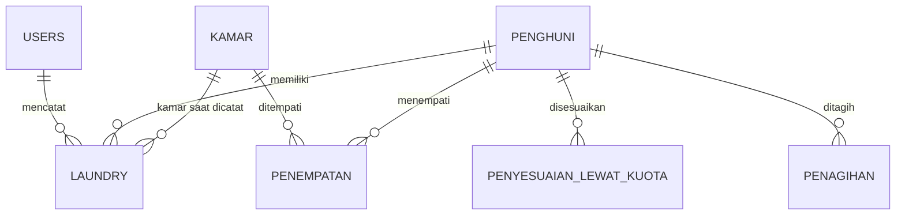

# Rancangan: Aplikasi Web Catatan Laundry (Laravel)

> Aplikasi internal untuk mencatat laundry penghuni kos, menghitung kuota dan tagihan lewat kuota, mencetak laporan seperti di aplikasi Android lama,
> dan mengirim tagihan lewat `wa.me`. Hanya laundry (bukan kelola kos penuh). Web dulu; mobile menyusul memakai API dari backend yang sama.
>
> File pendamping: `seed_penghuni_aktif.csv` (30 penghuni aktif + nomor WhatsApp), `seed_laundry_nov_uji.csv` (data uji November), dan `PROMPT-LARAVEL-LAUNDRY.md` (prompt per tahap untuk agent).

---

## 1. Ruang lingkup

| Termasuk | Tidak termasuk (sengaja) |
|---|---|
| CRUD catatan laundry (penghuni / gedung / tanpa nama, item terpisah) | Kontrak, tagihan sewa, deposit, operasional, laporan keuangan |
| Kuota bulanan per penghuni, status, tagihan lewat kuota | Pembayaran online, portal penghuni |
| Daftar penghuni + nomor WhatsApp | Survei, kerusakan, cleaning, fasum |
| **Mini-kontrak**: masuk, **pindah kamar**, **keluar**, batalkan keluar, ganti nomor | Chat, jelajah kos, multi-properti |
| Laporan (tampilan sama seperti Android) + cetak/simpan PDF | Banyak pemilik/workspace (itu tugas versi SaaS) |
| Pesan `wa.me`: tagihan per penghuni dan rekap | |
| API `v1` untuk aplikasi mobile nanti | |

Stack: **Laravel** (versi stabil terbaru yang didukung PHP 8.3 ke atas), **MySQL 8**, **Blade + Tailwind CSS + Alpine.js** (kemasan awal Laravel Breeze stack Blade sudah memuat ketiganya),
tanpa Livewire/Inertia agar kode sedikit dan mudah dirawat. Tema mengikuti aplikasi Android lama (bagian 8).

---

## 2. Temuan dari data yang kamu kirim

| # | Temuan | Dampak pada rancangan |
|---|---|---|
| 1 | **Kuota di aplikasi lama dikelompokkan per kontrak** (cadangannya per kamar), dan pindah kamar dikerjakan sebagai "akhiri kontrak + buat kontrak baru" | Penyebab kuota tidak terbawa. Di sini kuota dikunci ke **penghuni**, bukan kamar atau kontrak (bagian 5) |
| 2 | Rekap November (sampai 17 Nov): **25 catatan berat tidak punya harga** ("belum tertera harga"), tersebar di 16 dari 29 penghuni/baris. Biaya utama tercatat Rp1.599.200, seharusnya ±Rp2.232.000 (selisih ±Rp632.800) | **Biaya wajib dihitung otomatis** saat simpan (bisa di-override), dan ada alat "lengkapi harga kosong" untuk data lama (bagian 3.2) |
| 3 | Satu penghuni di kamar 307 tertulis dengan dua nama berbeda di laporan laundry dan di daftar penghuni | Kolom `alias` pada penghuni; seed memakai nama dari daftar penghuni dan mencatat aliasnya |
| 4 | Satu penghuni pindah 307 ke 310 pada 10 ke 11 November; total laundry bulan itu 12,2 kg lintas dua kamar | Dijadikan **kasus uji utama** pindah kamar |
| 5 | Dua penghuni aktif belum punya catatan laundry bulan ini | Normal; tampil di Beranda sebagai "belum ada catatan" (opsional) |
| 6 | Rekap WhatsApp yang kamu pakai (judul tebal, poin per catatan, ringkasan) | Dijadikan template **Rekap** (bagian 3.5) |
| 7 | Laporan PDF lama memuat teks mentah `&middot;` di batang total | Diperbaiki di versi baru |
| 8 | Dua nomor tampak tidak lazim (satu terlalu pendek, satu terlalu panjang) | Validasi nomor menampilkan peringatan, bukan menolak |
| 9 | Kolom tanggal masuk banyak yang bertanggal 31 Mei 2026 (tanggal impor awal) | Ditandai "perkiraan"; tidak memengaruhi kuota |

---

## 3. Fitur dan halaman

Navigasi: sidebar di desktop, **bottom bar di HP** (Beranda · Laundry · Penghuni · Laporan · Lainnya), seperti aplikasi Android.

### 3.1 Beranda
- Kartu **"Peringatan kuota"** (daftar penghuni mendekati atau lewat kuota bulan ini) dan ringkasan bulan ini: total kg, jumlah penghuni mencatat, biaya utama, bayar terpisah.
- Pintasan: Tambah laundry, Laporan bulan ini, Kirim peringatan WhatsApp.
- Kartu opsional: "Belum ada catatan bulan ini" (penghuni aktif tanpa laundry).

### 3.2 Laundry (CRUD)
**Daftar**
- Filter periode: Hari ini · 7 hari · Bulan ini · Bulan lalu · Semua · Dari–Sampai. Pencarian pemilik/pencatat/kamar.
- Kartu ringkasan: Total berat, kuota gratis, biaya utama, bayar terpisah (n catatan, m item).
- Banner peringatan kuota. Tiap baris: ikon, "Kamar 302 - 2,8 kg", pemilik, tanggal, "Kuota November: 17,8/20 kg - mendekati", pencatat, tombol ubah dan hapus.
- Penghapusan **lunak** (soft delete) dengan toast "Dihapus · Batalkan", dan halaman "Terhapus" untuk memulihkan.

**Form tambah/ubah** (sama dengan aplikasi lama)
- Jenis pemilik: **Penghuni** (pilih kamar, daftar hanya penghuni aktif pada tanggal itu) · **Gedung** (tidak memakai kuota) · **Tanpa nama** (tidak mengurangi kuota sampai ditetapkan).
- Tanggal, **berat utama (kg)**, **biaya utama** (kosong = otomatis `max(berat, min) × tarif`, berubah mengikuti isian), catatan.
- **Item terpisah**: pilihan cepat (Selimut, Sprei, Bed cover, Lainnya) + nama, berat, jumlah, biaya; dibayar terpisah, tidak masuk kuota.
- Teks bantu **langsung** (Alpine memanggil endpoint ringan): "Pemakaian bulan ini: 11,5/20 kg (sisa gratis 8,5 kg)" saat penghuni dan tanggal dipilih.
- Validasi: berat > 0 dan ≤ 30 kg (lebih besar perlu centang "Saya yakin"), tanggal tidak boleh sebelum tanggal masuk atau sesudah tanggal keluar penghuni, tidak boleh dobel (kunci idempotensi opsional).

**Perbaikan dari aplikasi lama**
- Tombol **"Lengkapi harga kosong"** (admin): menghitung ulang biaya hanya untuk catatan yang `biaya_utama` kosong atau 0, dengan pratinjau jumlah dan nilai sebelum disimpan.
- **Edit massal** tanggal/kamar bila salah input; **Riwayat perubahan** per catatan.
- Catatan "tanpa nama" bisa **ditetapkan** ke penghuni (kuota ikut berubah).

### 3.3 Penghuni (mini-kontrak)
**Daftar**: tab Aktif · Keluar · Semua; kolom kamar, nama, tombol **WhatsApp** (`wa.me`), status, mini-bar kuota bulan ini; pencarian nama/kamar/nomor.

**Detail penghuni**: data diri, nomor WA, **riwayat kamar** (garis waktu), kuota per bulan (grafik batang sederhana), daftar laundry.

**Aksi** (admin; tombol di detail dan menu titik tiga di daftar):

| Aksi | Isi dan aturan |
|---|---|
| **Masuk (tambah penghuni)** | Nama, nomor WA, kamar (hanya yang kosong), tanggal masuk, catatan. Kuota penuh sejak bulan masuk (opsi prorata di Pengaturan, bawaan mati) |
| **Pindah kamar** | Kamar tujuan (hanya yang kosong pada tanggal itu), tanggal efektif. **Kuota tidak berubah.** Pratinjau: "Kuota Nov: 11,0/20 kg tetap berlaku di kamar baru". Menutup penempatan lama dan membuka yang baru dalam satu transaksi |
| **Keluar** | Tanggal keluar, alasan. Peringatan bila bulan itu masih ada tagihan lewat kuota/bayar terpisah. Setelah itu laundry baru ditolak, riwayat tetap ada |
| **Batalkan keluar** | Hanya bila kamar lamanya masih kosong; menghapus tanggal keluar |
| **Ganti nomor WhatsApp** | Normalisasi otomatis ke format `62…`, peringatan bila panjang tidak lazim, tercatat di riwayat |
| **Ubah data / alias** | Nama, alias, catatan |

Aksi lain yang direkomendasikan, kecil dan relevan: **Koreksi tanggal masuk** (menandai tanggal perkiraan menjadi pasti) dan **Gabungkan duplikat** (dua nama sama untuk satu orang).

### 3.4 Laporan
- Filter: periode (rentang tanggal), cetak data **Semua penghuni/kamar** atau satu kamar/penghuni, opsi "rinci".
- Tampilan **sama dengan laporan Android**: judul properti dan periode, catatan kecil, "LAPORAN LAUNDRY" berwarna emas di kanan, tiga kotak ringkasan (Total laundry · Jumlah penghuni · Mendekati/Lewat), lalu kartu per penghuni **dua kolom**.
- Isi kartu: lencana kamar, nama, "n catatan - Penghuni", kg besar di kanan, baris "Kuota: x / 20,0 kg kuota bulan ini" (ditambah "Periode ini y kg" bila periode tidak sama dengan satu bulan penuh, dan "Lewat bulan ini z kg" bila lewat), chip status (Normal · Mendekati kuota · Lewat kuota), daftar catatan dengan garis titik-titik, **"Subtotal semua"**, batang hijau **Biaya utama**, batang merah **Tagihan lewat kuota** (ada label "disesuaikan" bila di-override), batang emas **Bayar terpisah**, dan batang hijau **Kirim tagihan via WhatsApp** (tidak ikut tercetak).
- **Catatan merah**: catatan yang membuat kumulatif bulan itu melewati kuota (dan setelahnya) berwarna merah (aturan sudah dicocokkan dengan laporan Oktober).
- Penghuni yang sudah keluar diberi label "Keluar". Penghuni pindah kamar menampilkan jalur kamar, misalnya `307→310`.
- Batang total marun di bawah: "Total keseluruhan laundry" + ringkasan; catatan kaki: "Entri mengikuti filter tanggal. Kuota gratis dihitung dari total bulan terkait."
- **Cetak / Simpan PDF** memakai cetak browser (`window.print()`) dengan CSS cetak khusus (bagian 8.4). Di HP, hasilnya sama dengan "Cetak / Simpan PDF" pada aplikasi Android. PDF dari server (untuk dikirim otomatis) adalah opsi fase lanjut.
- Ekspor tambahan: **CSV**.

### 3.5 Pesan WhatsApp
Semua lewat tautan `https://wa.me/<nomor>?text=<pesan>` (WhatsApp Web di desktop, aplikasi di HP). Pesan **tidak terkirim otomatis**; pengguna menekan kirim.

| Jenis | Tujuan | Isi |
|---|---|---|
| **Tagihan per penghuni** | Nomor penghuni | Sapaan, rincian catatan, ringkasan kuota, total tagihan (lewat kuota + bayar terpisah), ajakan bayar QRIS dan kirim bukti |
| **Peringatan kuota** | Nomor penghuni | Pemberitahuan mendekati atau lewat kuota beserta sisa/lebihnya |
| **Rekap seluruh gedung** | `https://wa.me/?text=` (tanpa nomor: pilih grup/kontak sendiri) | Format seperti rekap yang kamu kirim: judul, per penghuni dengan poin tanggal, total, ringkasan keseluruhan |

Catatan teknis penting:
- Rekap seluruh gedung panjangnya ±5.000 karakter, terlalu panjang untuk tautan; sediakan tombol **Salin teks** (Clipboard API) dan **Bagikan** (Web Share API di HP) sebagai jalur utama, `wa.me/?text=` hanya bila pendek.
- Template **bisa diedit** di Pengaturan dengan variabel, dan tombol "Reset ke template awal". Variabel: `{nama}` `{kamar}` `{gedung}` `{periode}` `{rincian}` `{kuota_terpakai}` `{kuota}` `{sisa}` `{lewat_kg}` `{tagihan_lewat}` `{terpisah}` `{total}`.
- Format tebal WhatsApp memakai `*teks*`; pesan memakai emoji secukupnya.

Template tagihan awal (diadaptasi dari aplikasi lama):

```
Halo *{nama}* (Kamar {kamar}),

Rincian laundry {periode}:
{rincian}

Pemakaian: {kuota_terpakai}/{kuota} kg (kuota gratis)
{tagihan_lewat}
💰 *Total Tagihan: {total}*

Silakan lakukan pembayaran melalui QRIS berikut dan kirim bukti pembayarannya.
Terima kasih 🙏
```

**Pengingat kuota** (opsional, fase lanjut): perintah terjadwal `php artisan laundry:cek-kuota` dengan penjaga duplikat (satu per penghuni per bulan per tingkat) yang mengirim ringkasan ke Telegram, atau cukup panel di Beranda + tombol WhatsApp.

### 3.6 Pengaturan (admin)
Aturan laundry **berversi dengan tanggal berlaku** (mengubahnya tidak mengubah catatan lama): tarif per kg, minimum kg, kuota kg, ambang "mendekati" (%), toleransi kg, pembulatan, mode kuota (`penghuni` atau `tanpa_kuota`, untuk kos yang punya laundry sendiri dan hanya mencatat), prorata bulan masuk (bawaan mati), nama properti, template WhatsApp, jam batas edit untuk penjaga.

### 3.7 Pengguna dan peran

| Peran | Hak |
|---|---|
| **admin** | Semua: pengaturan, pindah kamar/keluar, lengkapi harga, hapus, pengguna, riwayat |
| **penjaga** | Tambah laundry; ubah/hapus **catatan buatannya sendiri** dalam batas jam (bawaan 24 jam); lihat penghuni dan tombol WhatsApp; lihat laporan; **tanpa** pindah kamar/keluar/pengaturan |

Tanpa pendaftaran publik; akun dibuat oleh admin. Login email atau nama pengguna + password, pembatasan percobaan login, sesi bisa dicabut.

---

## 4. Aturan bisnis

Aturan berasal dari aplikasi lama dan sudah diuji terhadap data nyata (laporan Oktober dan rekap November).

| Aturan | Nilai bawaan | Catatan |
|---|---|---|
| Biaya per catatan | `max(berat, 2 kg) × Rp8.000` | Bisa di-override per catatan (`biaya_manual`) |
| Kuota | 20 kg per **penghuni** per **bulan kalender** (zona waktu Asia/Jakarta) | Dijumlahkan dari semua kamar bulan itu |
| Status | Normal < 75% kuota · **Mendekati** ≥ 75% dan ≤ kuota · **Lewat** > kuota | Tepat 20,0 kg = mendekati |
| Tagihan lewat kuota | `kelebihan kg × tarif`, dibulatkan ke Rp1.000 | Hanya bila kelebihan ≥ toleransi 1 kg; bisa disesuaikan manual |
| Item terpisah | Biaya sendiri, tidak masuk kuota | Muncul sebagai "Bayar terpisah" |
| Total tagihan penghuni | **Tagihan lewat kuota + bayar terpisah** | Asumsi ⚠ konfirmasi (bagian 13); biaya utama adalah nilai internal yang ditutup kuota gratis |
| Gedung / tanpa nama | Tidak mengurangi kuota penghuni | "Tanpa nama" bisa ditetapkan ke penghuni |

Contoh yang diuji (data Oktober dan November):

| Kasus | Hasil |
|---|---|
| 23,0 kg, ada selimut Rp15.000 | lewat 3,0 kg → Rp24.000 + terpisah Rp15.000 |
| 25,3 kg | lewat 5,3 kg → Rp42.000 (42.400 dibulatkan) |
| 20,5 kg | lewat 0,5 kg → **tidak ditagih** (di bawah toleransi) |
| 22,6 kg | otomatis Rp21.000; disesuaikan jadi Rp20.800 |
| 21,0 kg (kasus November) | lewat 1,0 kg → tepat di batas toleransi: ditagih Rp8.000 ⚠ konfirmasi |
| 2 catatan 1,5 kg | masing-masing Rp16.000 (minimum 2 kg) |

---

## 5. Pindah kamar tanpa mereset kuota

**Akar masalah:** kuota dihitung per kontrak/kamar; pindah kamar membuat kontrak atau kamar baru, sehingga hitungan mulai dari nol.

**Solusi di rancangan ini:**
1. Kuota selalu dihitung dari `laundry.penghuni_id` dalam satu bulan kalender; **tidak ada** `WHERE kamar = …` pada perhitungan kuota.
2. Penempatan kamar disimpan terpisah (`penempatan`), berurutan: `penghuni → kamar, mulai, selesai`.
3. Setiap catatan laundry menyimpan `kamar_id` **saat dicatat** (hanya untuk laporan per kamar dan riwayat).
4. Pindah kamar = tutup penempatan lama (`selesai` = tanggal pindah dikurangi 1 hari) dan buka yang baru (`mulai` = tanggal pindah), dalam satu transaksi dengan penguncian baris.

```
Penghuni X, November:  307: 3,5 + 4,1 + 2,0 kg   pindah 11 Nov   310: 2,6 kg
Kuota November X = 12,2 kg / 20 kg   (tidak ter-reset)
Laporan: kamar "307→310", 4 catatan, 12,2 kg
```

**Aturan:** kamar tujuan harus kosong pada tanggal efektif; tanggal pindah harus setelah mulai penempatan sebelumnya dan tidak melewati tanggal keluar; laundry tanggal ≥ tanggal pindah memakai kamar baru (otomatis dari penempatan); pindah dapat dibatalkan selama belum ada catatan laundry di kamar baru setelah tanggal itu.

**Integritas data di MySQL:** dua indeks unik pada kolom turunan (`storedAs`) memastikan **satu kamar hanya punya satu penempatan terbuka** dan **satu penghuni hanya satu penempatan terbuka** (bagian 6).

---

## 6. Model data (MySQL 8)



| Tabel | Kolom penting | Catatan |
|---|---|---|
| `users` | id, name, email (unik), password, role (`admin`/`penjaga`), aktif | Tanpa registrasi publik |
| `kamar` | id, nomor (unik), lantai, aktif | Seed: 101–109, 201–210, 301–310, 401–402 (kamar uji 100 opsional dan nonaktif) |
| `penghuni` | id, nama, alias, no_wa (format `62…`), status (`aktif`/`keluar`), tanggal_masuk, tanggal_masuk_perkiraan (bool), tanggal_keluar, alasan_keluar, catatan, deleted_at | Indeks status dan nama |
| `penempatan` | id, penghuni_id, kamar_id, mulai (date), selesai (date, null = sekarang), sebab (`masuk`/`pindah`), dibuat_oleh | `kamar_terbuka` = `storedAs('IF(selesai IS NULL, kamar_id, NULL)')` **unik**; `penghuni_terbuka` = `storedAs('IF(selesai IS NULL, penghuni_id, NULL)')` **unik** |
| `laundry` | id, tanggal (date), jenis (`penghuni`/`gedung`/`tanpa_nama`), penghuni_id (null), kamar_id (null; kamar saat dicatat), berat_kg decimal(6,2) null, biaya_utama int unsigned, biaya_manual bool, item_nama, item_jumlah, item_berat_kg, item_biaya, catatan, ref (unik, null; idempotensi), dicatat_oleh, deleted_at | Indeks (penghuni_id, tanggal) dan (tanggal) |
| `penyesuaian_lewat_kuota` | id, penghuni_id, bulan (`YYYY-MM`), nominal, catatan, oleh | Unik (penghuni_id, bulan); menyimpan **hanya** override manual |
| `pengaturan` | id, kunci, nilai (text), berlaku_mulai (date), diubah_oleh | Unik (kunci, berlaku_mulai); nilai berlaku = baris terbaru dengan `berlaku_mulai` ≤ tanggal |
| `penagihan` (opsional, fase 7) | id, penghuni_id, bulan, total, status (`belum`/`terkirim`/`lunas`), dikirim_pada, lunas_pada | Melacak siapa sudah ditagih dan membayar |
| `notifikasi_kuota` (opsional) | kunci unik (`bulan:penghuni:tingkat`), dikirim_pada | Penjaga duplikat |
| `audit_log` | id, user_id, aksi, subjek_type, subjek_id, sebelum (JSON), sesudah (JSON), ip, created_at | Dasar fitur riwayat dan pulihkan |
| `personal_access_tokens` | (Sanctum) | Untuk mobile (bagian 9) |

Aturan data: uang `int` rupiah; berat desimal; tanggal sewa dan laundry bertipe **DATE** (tanpa jam, hindari pergeseran zona waktu); zona waktu aplikasi `Asia/Jakarta`; semua perubahan penting masuk `audit_log`.

Kunci pengaturan: `nama_properti`, `tarif_per_kg`, `min_kg`, `kuota_kg`, `ambang_mendekati_persen`, `toleransi_kg`, `pembulatan`, `mode_kuota`, `kuota_prorata_bulan_masuk`, `template_wa_tagihan`, `template_wa_peringatan`, `template_wa_rekap`, `jam_edit_penjaga`.

---

## 7. Arsitektur Laravel

Monolit Blade; **controller tipis**, logika di service. Web dan API (bagian 9) memakai service dan Form Request yang sama sehingga hasilnya identik.

```
app/
  Models/            User, Kamar, Penghuni, Penempatan, Laundry, PenyesuaianLewatKuota, Pengaturan, AuditLog
  Services/
    PengaturanService     nilai aturan pada tanggal tertentu (berversi, di-cache)
    HargaService          hitungBiaya(berat, tanggal)
    KuotaService          statusBulan(penghuni, 'YYYY-MM'), ringkasanSemua('YYYY-MM') (satu query GROUP BY, tanpa N+1)
    PenempatanService     masuk, pindahKamar, keluar, batalkanKeluar (transaksi + lockForUpdate)
    LaporanService        susun(dari, sampai, filter) → struktur kartu per penghuni + penanda catatan merah
    WaService             normalisasiNomor, linkTagihan, linkPeringatan, teksRekap
    ImporService          CSV seed, backup JSON aplikasi lama, ekspor kos_laundry.py
  Http/Controllers/       BerandaController, LaundryController, PenghuniController (+ aksi), LaporanController, PengaturanController, UserController
  Http/Requests/          LaundryRequest, PindahKamarRequest, KeluarRequest, GantiNomorRequest, PengaturanRequest
  Policies/               LaundryPolicy (penjaga: milik sendiri dan dalam batas jam), PenghuniPolicy
  Console/Commands/       laundry:impor-seed, laundry:impor-backup, laundry:lengkapi-harga, laundry:cek-kuota
resources/views/
  components/             kartu, lencana-status, batang-ringkasan, modal, form-field, toast
  laundry/ penghuni/ laporan/ pengaturan/
```

Rute utama (web):

| Rute | Fungsi |
|---|---|
| `GET /` | Beranda |
| `GET /laundry` · `POST /laundry` · `PUT/DELETE /laundry/{id}` · `POST /laundry/{id}/pulihkan` | Daftar dan CRUD |
| `GET /laundry/kuota?penghuni=&tanggal=` | Teks bantu langsung (JSON ringan untuk Alpine) |
| `POST /laundry/lengkapi-harga` | Hitung ulang harga kosong (pratinjau lalu simpan) |
| `GET /penghuni` · `GET /penghuni/{id}` · `POST /penghuni` | Daftar, detail, masuk |
| `POST /penghuni/{id}/pindah-kamar` · `/keluar` · `/batalkan-keluar` · `/ganti-nomor` | Aksi mini-kontrak |
| `GET /laporan` · `GET /laporan/cetak` · `GET /laporan.csv` | Laporan layar, tampilan cetak, ekspor |
| `GET /wa/tagihan/{penghuni}` · `/wa/rekap` | Mengembalikan teks dan tautan `wa.me` |
| `GET/PUT /pengaturan` | Aturan dan template |

Praktik: `Form Request` untuk validasi, `Policy` untuk hak akses, transaksi `DB::transaction` untuk aksi yang mengubah beberapa tabel, `audit_log` melalui observer, antrean tidak diperlukan.

---

## 8. Tampilan dan tema

### 8.1 Token warna (diambil dari kode aplikasi Android lama)

| Token | Hex | Pemakaian |
|---|---|---|
| `maroon` | `#8B1A1A` | Warna utama: header, tombol, batang total |
| `maroon-cerah` | `#A11D1D` | Hover tombol |
| `maroon-strong` | `#C42626` | Aksen kuat |
| `gold` | `#C8920E` | Aksen: judul laporan, angka ringkasan, tombol sekunder |
| `gold-bright` | `#D4A017` | Aksen terang |
| `gold-soft` | `#E8C25A` | Aksen mode gelap |
| `gold-container` | `#FBF1D8` | Latar peringatan, batang "bayar terpisah", lencana "mendekati" |
| `on-gold` | `#6B4E08` | Teks di atas gold-container |
| `bg` | `#F9F5F0` | Latar halaman |
| `surface` | `#FFFFFF` | Kartu |
| `surface-alt` | `#FCFAF6` | Kotak catatan di dalam kartu |
| `surface-sunken` | `#F1EBE2` | Latar kolom pencarian dan area tenggelam |
| `outline` / `outline-strong` | `#ECE5DB` / `#E0D7C9` | Garis kartu |
| `ink` | `#1C1C1C` | Teks utama |
| `muted` / `subtle` | `#6B7280` / `#9A938A` | Teks sekunder |
| `ok` | `#16A34A` | Normal, batang biaya utama, tombol WhatsApp |
| `warn` | `#CA8A04` | Mendekati |
| `danger` | `#DC2626` | Lewat kuota, tagihan lewat kuota |
| `info` | `#2563EB` | Ikon laundry |

Mode gelap (opsional, seperti aplikasi lama): `gold #E8C25A`, `gold-container #352A12`, `surface-alt #2B221D`, `surface-sunken #1A1410`, `outline #382D27`, `outline-strong #473A32`, `muted #B7AAA0`, `subtle #857A71`.
Latar batang dan lencana memakai versi terang dari `ok`/`danger` (±10% opasitas). Font: **Roboto**; sudut membulat besar (kartu ±16 px, tombol penuh ±12 px); bayangan sangat halus.

Contoh `tailwind.config.js`:

```js
theme: { extend: { colors: {
  maroon: { DEFAULT:'#8B1A1A', cerah:'#A11D1D', strong:'#C42626' },
  gold:   { DEFAULT:'#C8920E', bright:'#D4A017', soft:'#E8C25A', container:'#FBF1D8', on:'#6B4E08' },
  bg:'#F9F5F0', alt:'#FCFAF6', sunken:'#F1EBE2', line:'#ECE5DB', 'line-strong':'#E0D7C9',
  ink:'#1C1C1C', muted:'#6B7280', subtle:'#9A938A',
  ok:'#16A34A', warn:'#CA8A04', danger:'#DC2626', info:'#2563EB',
}}}
```

### 8.2 Komponen Blade
`<x-kartu>`, `<x-lencana status="normal|mendekati|lewat|keluar">`, `<x-batang tipe="biaya|lewat|terpisah|wa">`, `<x-ringkasan-tile>`, `<x-modal>` (Alpine), `<x-field>`, `<x-toast>`, `<x-bottom-nav>`. Interaksi dengan Alpine saja (modal, form dinamis item terpisah, teks bantu kuota, salin/bagikan teks, hitung biaya otomatis).

### 8.3 Layout
Mobile-first. HP: header marun dengan nama properti, konten satu kolom, **bottom bar**. Desktop: sidebar kiri, konten lebar maksimum, kartu laporan dua kolom.

### 8.4 CSS cetak laporan
`@page { size: A4; margin: 10mm; }`; sembunyikan navigasi dan batang WhatsApp (`print:hidden`); kartu penghuni `break-inside-avoid`; susunan **dua kolom** (`columns-2` atau grid); warna latar dicetak (`print-color-adjust: exact`); font Roboto lokal (paket npm) agar cetak tidak bergantung internet; halaman dipaksa terang (abaikan mode gelap). Tombol "Cetak / Simpan PDF" berwarna emas, tetap di bawah layar seperti aplikasi lama.

---

## 9. API untuk aplikasi mobile (fase lanjut)

Prinsip: **mobile mencerminkan web lewat API**, bukan membuat logika sendiri.
- Prefiks `/api/v1`, autentikasi **Laravel Sanctum** (token per perangkat, bisa dicabut), respons lewat **API Resource** (bentuk JSON stabil), kode galat seragam, `X-Request-Id` untuk pelacakan.
- Controller API memanggil **service yang sama** dengan web.

| Endpoint | Fungsi |
|---|---|
| `POST /auth/login` · `POST /auth/logout` · `GET /me` | Sesi |
| `GET/POST/PUT/DELETE /laundry` | CRUD (dengan `ref` untuk idempotensi saat sinyal buruk) |
| `GET /kuota?penghuni=&bulan=` · `GET /kuota/ringkasan?bulan=` | Status kuota |
| `GET /penghuni` · `GET /penghuni/{id}` · `POST /penghuni` | Penghuni |
| `POST /penghuni/{id}/pindah-kamar` · `/keluar` · `/batalkan-keluar` · `/ganti-nomor` | Aksi |
| `GET /laporan?dari=&sampai=` | Data laporan (JSON) |
| `GET /wa/tagihan/{penghuni}` · `GET /wa/rekap` | Teks dan tautan |
| `GET /pengaturan` | Nilai aturan aktif (untuk perhitungan teks bantu di klien) |

Dokumentasikan dengan OpenAPI (mis. Scribe) agar klien mobile (Flutter atau lainnya) bisa dibangkitkan dari kontrak. Karena data uang dan kuota dihitung di server, aplikasi mobile hanya menampilkan.

---

## 10. Data awal dan impor

| Sumber | Isi | Perintah |
|---|---|---|
| `seed_penghuni_aktif.csv` | 30 penghuni aktif (kamar, nama, alias, nomor asli dan format `62…`, tanggal masuk, catatan); satu penghuni punya penempatan sebelumnya (kamar 307) | `php artisan laundry:impor-seed` |
| `seed_laundry_nov_uji.csv` | 94 baris laundry November (sampai 17 Nov) dari rekapmu; baris tanpa harga dibiarkan kosong agar terlihat | `php artisan laundry:impor-seed --laundry` |
| Backup JSON aplikasi Android (menu Backup Data) | Penghuni, kontrak, laundry asli lengkap dengan nomor WA terbaru | `php artisan laundry:impor-backup file.json` |
| Ekspor `kos_laundry.py` (agent Hermes) | Penghuni, penempatan, laundry | `php artisan laundry:impor-hermes ekspor.json` (bila dipakai) |

Pemetaan backup Android: `penghuni/*` → `penghuni` (nama, `no_wa`), `kontrak/*` → `penempatan` (kamar + tanggal masuk/keluar; pasangan kontrak "selesai lalu langsung aktif" untuk penghuni yang sama dideteksi sebagai **pindah kamar** dan diusulkan), `laundry/*` → `laundry` (snake_case: `berat_kg`, `jenis_pemilik`, `layanan_laundry`, `berat_terpisah_kg`, `biaya_terpisah`, …). Impor bersifat **idempoten** dan menyediakan mode `--dry-run` dengan laporan anomali (nomor tidak lazim, nama ganda, harga kosong, catatan di luar masa tinggal).

Catatan: sumber asli data November ada di aplikasi Android (Firebase), bukan di CSV uji. Untuk produksi, **ekspor backup terbaru** lalu impor; CSV uji hanya untuk menguji laporan dan aturan.

---

## 11. Rencana tes (berbasis data nyata)

| Area | Kasus |
|---|---|
| Biaya | 2,0 kg → Rp16.000; 1,5 kg → Rp16.000; override manual tersimpan dan tidak tertimpa perhitungan ulang |
| Kuota | 23,0 kg → lewat 3,0 → Rp24.000; 25,3 kg → Rp42.000; 20,5 kg → tidak ditagih; 20,0 kg → mendekati; 14,5 kg → normal |
| Override | Tagihan lewat kuota disesuaikan Rp20.800 lalu direset kembali ke otomatis |
| Item terpisah | Tidak masuk kuota; muncul di "Bayar terpisah" |
| **Pindah kamar** | 3,5 + 4,1 + 2,0 kg di kamar lama + 2,6 kg di kamar baru = 12,2 kg, kuota tidak ter-reset; kamar lama jadi kosong; catatan baru di kamar lama ditolak; pindah ke kamar terisi ditolak; dua penempatan terbuka ditolak oleh indeks unik |
| Keluar | Laundry setelah tanggal keluar ditolak; riwayat tetap tampil; batalkan keluar hanya bila kamar masih kosong |
| Berversi | Tarif baru berlaku 1 Desember tidak mengubah catatan November; kuota baru berlaku sesuai tanggal |
| Laporan | Total November harus **278,9 kg** dari 94 baris uji; catatan yang melewati kuota berwarna merah; penghuni pindah kamar tampil `307→310`; periode parsial menampilkan "Periode ini" |
| WhatsApp | Nomor `08…`, `62…`, `+62…` dinormalisasi sama; teks tagihan dan rekap sesuai template; variabel kosong tidak menghasilkan `{}` mentah |
| Hak akses | Penjaga tidak bisa pindah kamar/keluar/pengaturan; penjaga tidak bisa mengubah catatan orang lain atau yang melewati batas jam |
| Integritas | Penghapusan lunak dan pulihkan; `audit_log` mencatat sebelum dan sesudah; tidak ada N+1 pada Beranda dan Laporan |

---

## 12. Fase pembangunan

| Fase | Isi | Selesai bila |
|---|---|---|
| **1 Fondasi** | Proyek Laravel, Breeze Blade, tema Tailwind, migrasi, seed kamar dan penghuni, login dan peran | Bisa masuk, data seed tampil, tema mirip Android |
| **2 Penghuni & penempatan** | Daftar/detail, masuk, **pindah kamar, keluar**, batalkan keluar, ganti nomor, `KuotaService` | Tes pindah kamar dan kuota lulus |
| **3 Laundry** | CRUD, form dinamis (jenis, item terpisah, teks bantu kuota), filter, hapus lunak/pulihkan, lengkapi harga kosong | Entri November tampil dan total cocok |
| **4 Laporan** | Layar laporan, CSS cetak dua kolom, CSV | Cetak/PDF dari HP mirip laporan Android; total 278,9 kg |
| **5 WhatsApp & pengaturan** | Template tagihan/peringatan/rekap, salin/bagikan, pengaturan berversi | Pesan sesuai contoh; tarif/kuota bisa diubah dengan tanggal berlaku |
| **6 API v1** | Sanctum, Resource, OpenAPI, tes API | Semua aksi utama bisa dilakukan lewat API |
| **7 Opsional** | `penagihan` (terkirim/lunas), pengingat Telegram, PDF server, mode gelap | Sesuai kebutuhan |
| **Deploy** | VPS (Nginx, PHP-FPM, MySQL), HTTPS, `mysqldump` harian ke luar VPS, `.env` rahasia | Dipakai harian oleh penjaga |

---

## 13. Keputusan dan pertanyaan terbuka (⚠)

| # | Pertanyaan | Default yang dipakai |
|---|---|---|
| 1 | **Apa yang ditagihkan ke penghuni?** Saya asumsikan hanya *tagihan lewat kuota + bayar terpisah* (biaya utama ditutup kuota gratis) | Seperti itu |
| 2 | Kelebihan **tepat 1,0 kg** (kasus November) ditagih atau tidak? Aturan lama: ditagih bila ≥ 1 kg | Ditagih (Rp8.000) |
| 3 | Penjaga boleh **pindah kamar/keluar**, atau admin saja? | Admin saja |
| 4 | Kuota **prorata** untuk penghuni yang masuk/keluar tengah bulan? | Tidak (kuota penuh) |
| 5 | Nama penghuni di kamar 307: ikut daftar penghuni, alias dari laporan | Daftar penghuni |
| 6 | Perlu **status penagihan** (terkirim/lunas) per penghuni per bulan? | Fase 7 opsional |
| 7 | Perlu **pengingat otomatis** (Telegram) atau cukup panel dan tombol WA? | Panel + tombol dulu |
| 8 | Mode gelap perlu sejak awal? | Tidak |

---

## 14. Jalur ke versi SaaS nanti

Rancangan ini sengaja cocok dengan spesifikasi SaaS (`indekos-saas-spesifikasi.md`): `penempatan` setara `kontrak_penempatan` (bagian 4.1 di sana), kuota tetap per penghuni, pengaturan modul laundry berversi dengan tanggal berlaku,
catatan menyimpan `kamar_id` saat dicatat, dan semua logika di service. Saat SaaS dibangun, tabel dan data bisa dimigrasikan, atau aplikasi ini dipakai sebagai modul Laundry setelah ditambah `workspace_id`.
